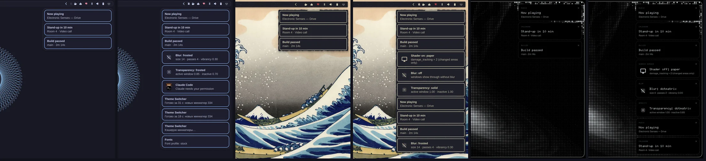

# Omarchy Drawer Notifications

[🇷🇺 Русский](README.ru.md)

[Omarchy](https://omarchy.org) notifications (a clone of the stock `omarchy.notifications`) where the toasts
share one panel. With a solid bar glued to the edge — for example the `frame` skin of
[omarchy-bar-skins](https://github.com/KamradSmeshnyavy/omarchy-bar-skins) — the panel is glued to the bar and the
screen edge with concave corners; with a transparent or floating bar it is a floating card with a gap and a
shadow. Its height follows the number of toasts. The daemon, Do Not Disturb, history and IPC are stock.



<!-- Demo video: repo-videos/omarchy-drawer-notifications.mp4 — drag it here when editing this file on GitHub -->

## Install

```sh
omarchy plugin add https://github.com/KamradSmeshnyavy/omarchy-drawer-notifications --enable
omarchy restart shell
```

Blur under a glass panel (Hyprland Lua config):
`hl.layer_rule({ match = { namespace = "omarchy-notifications" }, blur = true, ignore_alpha = 0.2 })`.
A sound per toast, if `~/.local/bin/omarchy-sound` exists (from the author's dotfiles), is played on show.

## Requirements

Omarchy 4 (Quattro) with its shell. Tested on Omarchy 4.0.6 with Quickshell 0.3.2.

- Nothing beyond Omarchy (`notify-send` from libnotify).
- Optional: the [Customizer](https://github.com/KamradSmeshnyavy/omarchy-customizer) — its Style presets (Flat, Glass, Fluent, DOT-MATRIX) write `~/.config/omarchy/style.json`, which this plugin follows; without it the defaults are used.
- DOT-MATRIX designs use the fonts shipped with the [Customizer](https://github.com/KamradSmeshnyavy/omarchy-customizer) (Doto, Space Grotesk, Space Mono); without them they fall back to the Omarchy font.

## Uninstall

```sh
omarchy plugin enable omarchy.notifications      # switch back to the stock one first
omarchy plugin remove kamradsmeshnyavy.notifications
omarchy restart shell
```

Your settings stay in `~/.config/omarchy/notify-style.json`, `~/.config/omarchy/glyph.json` — delete them by hand if you don't need them.

## Settings

`~/.config/omarchy/notify-style.json`, re-read live. The
[Customizer](https://github.com/KamradSmeshnyavy/omarchy-customizer) edits it under Windows → Notifications.

```jsonc
{
  "notifyStyle": "drawer",      // drawer | stock
  "notifyCorner": "top-right",  // top-right | top-left | top-center
  "notifyWidth": 380,
  "notifyMax": 0,               // toasts visible at once; 0 — all (newest on top)
  "notifyCards": "flat",        // flat | bordered | dotmatrix
  "notifyFollowBar": true,      // colour, alpha, border, radius as the bar
  "notifyAttach": "auto",       // auto | attached | floating
  "notifyBackground": "background", "notifyAlpha": 0.94, "notifyRadius": 18
}
```

**Style tokens.** `~/.config/omarchy/style.json` (written by
[omarchy-customizer](https://github.com/KamradSmeshnyavy/omarchy-customizer) → Presets → Style) tunes the panels on top
of the bar: `elevation` 0–2 (shadows), `motion` (animation speed multiplier, 0 — none), `material`
(`auto` / `solid` / `glass`), `cornerScale` (0 — square corners), `typeface` (`shell` — Omarchy font, `profile` — the
sans of `~/.config/omarchy/fonts.json`, `hand` — handwritten Caveat; icons always stay on the Omarchy font).
`material` `paper` / `soft` / `brutal` / `bevel` / `glow` draws floating panels with `StyleCard.qml`: a sheet of
paper (torn edge, `texture` tile, tape), neumorphic relief, a thick border with a hard shadow, a retro bevel, neon glow. No file — the look as before.

Edits to the stock files are marked `// drawer:`. `BarStyle.qml` and `StyleCard.qml` are shared with
[omarchy-desktop-widgets](https://github.com/KamradSmeshnyavy/omarchy-desktop-widgets) and
[omarchy-edge-osd](https://github.com/KamradSmeshnyavy/omarchy-edge-osd).

## License

MIT (includes the stock Omarchy plugin it was cloned from).
