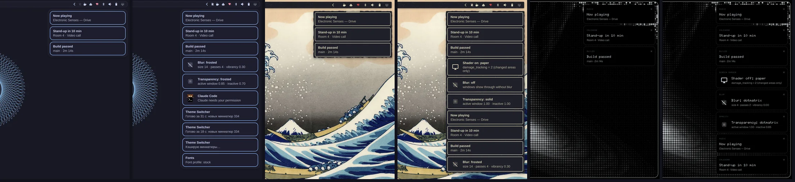

# Omarchy Drawer Notifications

[🇬🇧 English](README.md)

Уведомления [Omarchy](https://omarchy.org) (клон стокового `omarchy.notifications`), где тосты лежат в одной
панели. Со сплошным баром у края — например, скином `frame` из
[omarchy-bar-skins](https://github.com/KamradSmeshnyavy/omarchy-bar-skins) — панель прилипает к бару и краю
экрана вогнутыми углами; с прозрачным или плавающим баром — плавающая карточка с отступом и тенью. Высота
следует за числом тостов. Демон, «Не беспокоить», история и IPC — стоковые.



<!-- Demo video: repo-videos/omarchy-drawer-notifications.mp4 — drag it here when editing this file on GitHub -->

## Установка

```sh
omarchy plugin add https://github.com/KamradSmeshnyavy/omarchy-drawer-notifications --enable
omarchy restart shell
```

## Требования

Omarchy 4 (Quattro) с его оболочкой. Проверено на Omarchy 4.0.6 и Quickshell 0.3.2.

- Ничего, кроме Omarchy (`notify-send` из libnotify).
- Необязательно: [Customizer](https://github.com/KamradSmeshnyavy/omarchy-customizer) — его стили (Flat, Glass, Fluent, DOT-MATRIX) пишут `~/.config/omarchy/style.json`, плагин их подхватывает; без него — значения по умолчанию.
- Дизайны DOT-MATRIX используют шрифты из [Customizer](https://github.com/KamradSmeshnyavy/omarchy-customizer) (Doto, Space Grotesk, Space Mono); без них — шрифт Omarchy.

## Удаление

```sh
omarchy plugin enable omarchy.notifications      # сначала вернуть стоковый
omarchy plugin remove kamradsmeshnyavy.notifications
omarchy restart shell
```

Настройки остаются в `~/.config/omarchy/notify-style.json`, `~/.config/omarchy/glyph.json` — удалите их вручную, если не нужны.

## Настройки

`~/.config/omarchy/notify-style.json`, применяются на лету; [Customizer](https://github.com/KamradSmeshnyavy/omarchy-customizer) —
Окна → Уведомления. Ключи — в [README.md](README.md#settings): стиль, угол (справа / слева / по центру), ширина,
сколько тостов видно сразу, вид карточек (`flat` / `bordered` / `dotmatrix`), «следовать стилю бара», режим прилипания, свой фон / альфа / скругление.

Правки стоковых файлов помечены `// drawer:`.

**Токены стиля.** `~/.config/omarchy/style.json` (пишет
[omarchy-customizer](https://github.com/KamradSmeshnyavy/omarchy-customizer) → Пресеты → Стиль) настраивает панели поверх
бара: `elevation` 0–2 (тени), `motion` (множитель скорости анимаций, 0 — без них), `material` (`auto` / `solid` /
`glass`), `cornerScale` (0 — прямые углы), `typeface` (`shell` — шрифт Omarchy, `profile` — sans из
`~/.config/omarchy/fonts.json`, `hand` — рукописный Caveat; иконки всегда в шрифте Omarchy). `material` `paper` / `soft` /
`brutal` / `bevel` / `glow` рисует плавающие панели через `StyleCard.qml`: лист бумаги (рваный край, тайл `texture`, скотч),
неоморфный рельеф, толстая рамка с жёсткой тенью, ретро-кант, неоновое свечение. Нет файла — вид как раньше.

## Лицензия

MIT (вместе со стоковым плагином Omarchy, из которого сделан клон).

**Слияние.** У жидкого стиля карточка уведомлений встаёт вплотную к рамке / бару во всю длину края в своём углу и сливается с ними (вогнутые углы; у пластиковых основ там нет контура, у стекла — перешеек); геометрию бара `MergeInfo.qml` читает из `$XDG_RUNTIME_DIR/omarchy-bar-geom.json`.
